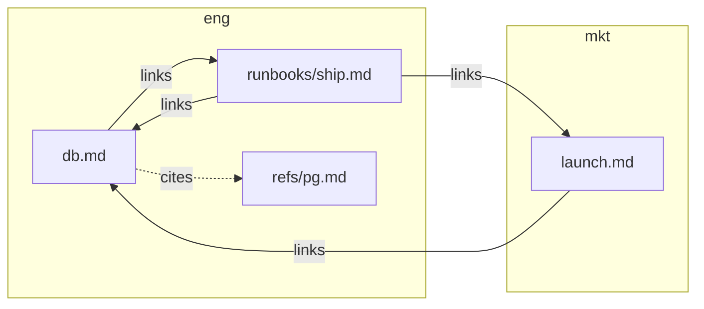

# Formats

!!! note "AI-generated"
    Written with Claude Opus 5.5 and Claude Sonnet 5.5, under human review. Every command and output on this page was run for real; long lines are shortened.

Bowerbird is not tied to one way of keeping knowledge. A `kbmcp.yaml` at the root of a folder says what the folder
holds, with one line:

```yaml
format: markdown      # markdown | adr | okf | skos | seal-only
```

Each format exists for a reason. Pick whichever fits what you keep; you can change your mind later by changing
that line (the search index rebuilds itself).

What you can do in each format (the tools a server offers, by job):

| Job | **Markdown** | **ADR** | **OKF** | **SKOS** | **Seal-only** |
|---|---|---|---|---|---|
| **Find**: ask a question, get the file and line to cite | yes: `passages` | yes: `passages` | yes: `passages`, `search`, `dirs`, `get`, `list`, `links` and more | yes: `passages` | no |
| **Author**: add files without breaking the collection | no | no | yes: `create`, `cite`, `record`, `set`, `lint`, `fix` | no | no |
| **Reorganize**: move, rename, split, import, with every link kept | no | no | yes: `move`, `rename`, `split`, `migrate`, `archive`, `ingest` | no | no |
| **Maintain**: keep it current and trustworthy | the search index only: `reindex` | the search index only: `reindex` | yes: `index`, `provenance`, `recheck_plan`, `recheck_apply`, `baseline`, `upgrade` and more | the search index only: `reindex` | no |
| **Attest**: a person's review, broken by any edit | yes: `seal` | yes: `seal`, with a decision | yes: `seal`, written into the file | yes: `seal` | yes: `seal` |
| **Tools offered** | 3 | 3 | 35 | 3 | 1 |

Over the command line every tool exists in every format, but outside OKF the other tools are written for OKF files and are
not meant for the rest. A server only offers the ones that fit.

| | **Markdown** | **ADR** | **OKF** | **SKOS** | **Seal-only** |
|---|---|---|---|---|---|
| **For** | notes, runbooks, wikis, docs | decisions, and why they were made | knowledge with sources, trust and freshness, kept by people and agents | glossaries, vocabularies, thesauri | code, configuration, any files that need a guaranteed human review |
| **Files** | any `.md` | `.md` decision records | `.md` concepts with frontmatter | `.ttl` `.rdf` `.jsonld` `.nt` `.n3` | any text files you name |
| **You must write** | nothing special | nothing special | frontmatter, at least `type` | RDF | nothing; you list the files |
| **A search hit is** | a section of a note | a section of a record, with its `status` | a section, with its trust tier and staleness | one concept | none: nothing is searched |
| **A review (`seal`) is kept in** | `.waxseal.yaml` | `.waxseal.yaml`, with a decision | the concept's own frontmatter | `.waxseal.yaml` | `.waxseal.yaml` |

All four share the same ideas: the folder is a git repository, `kbmcp.yaml` is committed with it, and a human's
review is recorded against the exact bytes they reviewed (see [Sealing](guide.md#sealing-who-reviewed-what)).

## Markdown

**Use it when** you have a folder of notes and want to ask questions of it and know which of them a person has
checked. There is nothing to learn and nothing to convert.

```text
notes/
  kbmcp.yaml             format: markdown
  deploy.md              plain Markdown, no header needed
  rollback.md
  .waxseal.yaml     appears when someone seals a note (commit it)
```

```yaml
# kbmcp.yaml
format: markdown
about: Team notes.
```

```sh
kb init holds=markdown about="Team notes." apply=true
kb passages 'how do I roll back' output=text
```

A hit is a section of a note, with its file and line:

```text
file: rollback.md, line: 2, heading: Rollback, match: 100, type: null, status: stable, tier: unverified, links: 1
text: To roll back, redeploy the previous tag and confirm the dashboard is green.
```

Every hit says `tier: unverified` until a human has sealed that file. `links` counts the notes that link to it
(`deploy.md` links to `rollback.md`, so it is 1). Files named `index.md` and `log.md` are ordinary notes here.

**Reviewing.** At a terminal, `kb seal deploy.md --attest` records you; over MCP a prompt asks you instead. The review
goes into `.waxseal.yaml`, never into the note:

```yaml
entries:
- file: deploy.md
  sha256: 6205ee8f20e4fa49559acc629e6639e87cc7ac5233fe496f18158236bdf659f6
  by: human:you
  at: 2026-11-16T14:40:51Z
```

Edit the note afterwards and the `sha256` no longer matches: the review is broken, and the hit shows `unverified` and
`stale`. `kb seal check=true` lists what has no review (for a pre-commit hook or CI).

## ADR

**Use it when** you keep decision records (ADR or MADR) and want to find them, see which are accepted, and have
a person ratify them.

```text
platform/
  kbmcp.yaml             format: adr
  docs/adr/
    0001-use-a-managed-queue.md      a Nygard record
    0002-use-postgresql.md           a MADR record
  .waxseal.yaml
```

```yaml
# kbmcp.yaml
format: adr
about: Platform decisions.
seal: {require: ["docs/adr/*.md"], exempt_status: [proposed, draft]}
```

Every Markdown file is a record (except `README.md` and `index.md`), whatever its name or folder. Bowerbird reads each
record's status as the author wrote it: from MADR 3 frontmatter, from a `## Status` section (Nygard), or from a
`* Status:` line (MADR 2).

```markdown
# 1. Use a managed queue

Date: 2026-11-16

## Status

Accepted

## Context

The platypus service needs a queue.
```

```markdown
---
status: proposed
date: 2026-11-16
decision-makers: platform team
---
# Use PostgreSQL

## Context and Problem Statement

Which database for the narwhal?
```

Hits carry `type: adr` and the record's `status`:

```text
file: docs/adr/0001-use-a-managed-queue.md, heading: 1. Use a managed queue > Decision, type: adr, status: Accepted, tier: unverified
file: docs/adr/0002-use-postgresql.md, heading: Use PostgreSQL > Context and Problem Statement, type: adr, status: proposed, tier: unverified
```

**Ratifying.** A record that says "Accepted" has only said so about itself. `kb ratify` (the same function as `seal`,
under the word ADRs use) records that a person reviewed it and what they decided:

```sh
kb ratify docs/adr/0001-use-a-managed-queue.md decision=accepted --attest
```

The `decision` goes into `.waxseal.yaml`, and from then on it is the hit's `status`, with `tier: human-reviewed`.
`kb seal check=true` fails a commit when a record that needs a review lacks one: `unsigned` for a required record,
`claims_accepted` for one whose own status says accepted but no person reviewed it, and `stale_signature` for one
edited after its review. A `proposed` or `draft` record is exempt, so you can commit a proposal before it is reviewed.

## OKF

**Use it when** the knowledge needs to say where it came from, who checked it and when it expires, especially when
agents write part of it. [Open Knowledge Format](understanding-okf.md) is a Markdown convention for exactly that: each
note (a *concept*) starts with a small header of facts, and the tools check that the whole folder is well formed.
It is the only format with the full toolset: `lint`, `fix`, `cite`, `provenance`, `status`, `move`, `rename` and the rest.

A collection is a folder of *bundles*; a bundle is a folder of concepts, one Markdown file each.

```text
kb/
  kbmcp.yaml               format: okf (the default)
  index.md                 lists the bundles
  eng/                     a bundle: its index.md declares okf_version "0.2"
    index.md
    log.md                 what changed, newest first
    db.md
    runbooks/ship.md
    refs/pg.md
  mkt/
    index.md
    log.md
    launch.md
```

Each concept is frontmatter (what kind of thing it is, where its facts came from, who checked it) over an ordinary
Markdown body. Here is `eng/db.md`:

```markdown
---
type: Reference
title: Database
description: The PostgreSQL cluster behind every service.
sources:
  - id: pg
    resource: refs/pg.md
verified: { by: human:dfoulks, at: 2026-10-27T14:00:00Z }
---

We run PostgreSQL 16.4.[^pg] Deploys follow [the ship runbook](/runbooks/ship.md).

[^pg]: PostgreSQL release notes
```

Concepts point at each other in two ways: a Markdown **link** in the body, and a **citation** in `sources`, which
records where a fact came from. `web output=mermaid` draws both for the whole collection:



Solid arrows are links; dotted ones are citations. The boxes are bundles, so an arrow that leaves its box crosses into
another bundle. That is allowed, but `lint` flags it, because the link breaks if one bundle is published alone.

**Try it.** In an empty folder:

```sh
kb init holds=okf about="Team runbooks." apply=true
kb create deploy type=Playbook title="Deploy" description="How we ship a release." \
   body='Run the deploy script, then check the dashboard.' output=text
kb cite deploy.md resource=https://example.com/runbook title="Ops runbook" output=text
kb lint output=text
```

`create` writes a file with its header, `cite` records a source and prints the footnote tag (`[^runbook]`) to put next to
the claim it backs, and `lint` checks the whole collection:

```text
bowerbird-mcp lint: ok: 1 concept(s) in 1 bundle(s) checked, 0 finding(s), conformant: True
```

A file with no header, a broken link or a fact with no source is a finding, each naming the file, what is wrong and how to
fix it, and `kb fix apply=true` repairs the mechanical ones.

**Reviewing.** `kb seal` writes a `verified` entry into the concept itself, with a `sha256` of the note. The trust tier
comes only from who verified: nobody means *unverified*, a script or agent means *machine-confirmed*, and a person
means *human-reviewed*. Hits show the tier and whether the note has gone stale. See
[Understanding OKF](understanding-okf.md) for the format itself.

## SKOS

**Use it when** you keep a controlled vocabulary: a glossary, a taxonomy, a thesaurus. SKOS is the W3C standard for
that, written as RDF (Turtle, RDF/XML, JSON-LD, N-Triples or N3).

```text
glossary/
  kbmcp.yaml             format: skos
  glossary.ttl
```

```turtle
@prefix : <http://example.org/glossary/> .
@prefix skos: <http://www.w3.org/2004/02/skos/core#> .
@prefix dct: <http://purl.org/dc/terms/> .

:scheme a skos:ConceptScheme ; dct:title "Infrastructure glossary" .

:service a skos:Concept ; skos:prefLabel "Service"@en ;
  skos:definition "A long-running process other systems depend on."@en ;
  skos:narrower :queue .

:queue a skos:Concept ; skos:prefLabel "Queue"@en ; skos:altLabel "message queue"@en ;
  skos:definition "A buffer that decouples a producer from a consumer."@en ;
  skos:broader :service .
```

Each `skos:Concept` is one passage. Its heading is the broader chain, and its text holds the labels, notes and
neighbouring concepts, so a search for the alternate label finds it:

```text
file: glossary.ttl, line: 11, heading: Infrastructure glossary > Service > Queue, type: skos, tier: unverified
text: Also: message queue / Definition: A buffer that decouples a producer from a consumer. / Broader: Service
```

SKOS needs the `rdflib` library. With `uvx`, ask for the extra in the client config: `"--from", "bowerbird-mcp[skos]>=2,<3"`
(the `.mcp.json` that `init` writes does not include it yet). A SKOS file is sealed as a whole, not per concept, and
links between concepts do not count towards ranking.

## Seal-only

**Use it when** you have files (code, configuration, policy) and want a guarantee that a human looked at the exact
version, enforced at commit time. Nothing is indexed or searched, so there are no hits and no `passages`: the only
tool is `seal`. It is the same review as in the other formats, with none of the knowledge machinery around it.

```text
service/
  kbmcp.yaml             format: seal-only
  .waxseal.yaml          the reviews (commit it)
  src/app.py
  config/limits.yaml
```

```yaml
# kbmcp.yaml
format: seal-only
about: Reviewed code.
seal: {require: ["src/**/*.py", "config/*.yaml"]}
```

`seal.require` is the list of files that need a review, as globs. It has to be set: `init holds=seal-only` writes it
empty, and `kb seal check=true` refuses to run until you fill it in. Any text file can be named; a file that is not
UTF-8 text is reported as `unreadable`, because it cannot be reviewed here.

```sh
kb init holds=seal-only about="Reviewed code." apply=true
kb seal check=true output=text
```

```text
config/limits.yaml: error: unsigned: no review by a human | fix: a human reviews it: seal config/limits.yaml
src/app.py: error: unsigned: no review by a human | fix: a human reviews it: seal src/app.py
bowerbird-mcp seal: FAILED: 2 file(s) checked, 2 finding(s)
```

A person reviews each file and seals it (`kb seal src/app.py --attest` at a terminal, or the prompt over MCP). The review
goes into `.waxseal.yaml`, bound to the file's exact bytes:

```yaml
entries:
- file: src/app.py
  sha256: ba1a531f581d2e6094e978ed6f7aca7a8d92eeb62c6e7ad73ee692f7f18bc772
  by: human:you
  at: 2026-11-16T15:01:31Z
```

Edit the file afterwards and the check fails again, until a person reviews the new version:

```text
src/app.py: error: stale_signature: edited since it was reviewed | fix: review it again: seal src/app.py
```

Wire `kb seal check=true` into a pre-commit hook and into CI (`since=origin/main` limits it to a pull request's files) and
no change to a listed file lands without a human review of that version. The prompt shows the start of the file; the
reviewer is trusted to have read the whole thing, or the diff.

## Changing your mind

Change the `format` line and run `kb reindex`; nothing else moves. Reviews are not converted between formats: an OKF
concept keeps its `verified` entries in its own frontmatter, while the other formats keep theirs in
`.waxseal.yaml`, so after a switch the notes may need sealing again.
