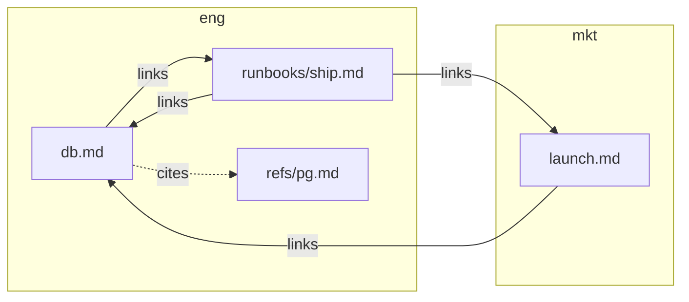

# OKF

<!-- seal-banner: Written with Claude Opus 5.5 and Claude Sonnet 5.5. Every command and output on this page was run for real; long lines are shortened. -->

**Use it when** the knowledge needs to say where it came from, who checked it and when it expires, especially when
agents write part of it. [Open Knowledge Format](#what-okf-is) is a Markdown convention for exactly that: each
note (a *concept*) starts with a small header of facts, and the tools check that the whole folder is well formed.
It is the only format with the full toolset: `lint`, `fix`, `fact`, `factcheck`, `provenance`, `status`, `move`, `rename` and the rest.

## What OKF is

**Open Knowledge Format** (OKF) is a way of writing down what you know so that people and AI assistants can both
use it. The whole format is this: **a folder of Markdown files, each starting with a short block of facts about
the file.** The specification calls that block *frontmatter* and writes it in YAML. That is the entire
technology. There is no database, no server, no registry of allowed types and no required software. In the
specification's own words: if you can `cat` a file you can read OKF, and if you can `git clone` a repository you
can ship it.

OKF is published as a specification (this site follows version 0.2) in the `knowledge-catalog` repository on
GitHub. Bowerbird is one tool that implements it: it writes, checks and searches OKF folders. Nothing in
the format depends on this tool, which is the point.

### Why a format at all?

A pile of Markdown notes is already easy to read. The trouble starts when the pile grows, other people add to it,
and AI assistants begin to *write* parts of it. Then readers need answers a plain note does not give:

1. **Where did this come from?** (provenance)
2. **Has anyone checked it, and was it a person or a script?** (trust)
3. **Is it still true?** (freshness)
4. **Is this the current version, or an old draft?** (lifecycle)

Without a convention, every team invents its own answers, and no tool can rely on them. OKF fixes a *small* set of
conventions for exactly these questions and leaves everything else to you.

## The pieces

A collection is a folder of *bundles*; a bundle is a folder of concepts, one Markdown file each.

```text
notes/
  bower.yaml               format: okf (the default)
  index.md                 lists the bundles
  eng/                     a bundle: its index.md declares okf_version "0.2"
    index.md
    log.md                 what changed, newest first
    db.md
    runbooks/ship.md
    refs/pg.md
  mkt/
    index.md
    log.md
    launch.md
```

Each concept is frontmatter (what kind of thing it is, where its facts came from, who checked it) over an ordinary
Markdown body. Here is `eng/db.md`:

```markdown
---
type: Reference
title: Database
description: The PostgreSQL cluster behind every service.
sources:
  - id: pg
    resource: refs/pg.md
verified: { by: human:you, at: 2026-10-27T14:00:00Z }
---

We run PostgreSQL 16.4.[^pg] Deploys follow [the ship runbook](/runbooks/ship.md).

[^pg]: PostgreSQL release notes
```

### The header fields

Only one is required. `type` says what kind of thing the file is (`Playbook`, `Reference`, `Metric` and so on).
Types are not registered anywhere: pick words that explain themselves, and readers must cope with ones they have
not seen. A file with nothing but `type` is fully valid.

The others are recommended or optional, in three families:

| Family | Fields | Answers |
|---|---|---|
| **Describing** | `title`, `description` (one sentence), `tags`, `resource` (a URI for the thing it describes) | What is this, for indexes and search results |
| **Provenance and trust** | `sources` (what it was built from), `generated` (who or what wrote the current text, and when), `verified` (who confirmed it, and when) | Where it came from and how far to trust it |
| **Lifecycle** | `status` (`draft`, `stable`, `deprecated`; absent means stable), `stale_after` (a date after which the content counts as stale) | Is it current |

Every timestamp is ISO 8601 with an explicit UTC offset, such as `2026-11-13T15:00:00Z`. Anything else you add is
yours: tools should keep keys they do not understand and must not reject a file for having them.

### Trust tiers

The tier is *derived*, never typed in. Look at who is in `verified`:

- nobody: **unverified**;
- only scripts, processes or agents: **machine-confirmed**;
- at least one person: **human-reviewed**.

Who is who is decided by a naming convention for **actors**: `human:<id>` for a person (`human:ann`),
`process:<id>` for an automated process (`process:finance-nightly`), and `<producer>/<version>` for an agent or
tool (`reference_agent/gemini-2.5-pro`). Because the tier keys off the `human:` prefix, anything a person wrote or
confirmed must use it. Two things to keep in mind: `generated` and `verified` are kept apart on purpose, because
who *wrote* a note need not be who *checked* it; and tiers are advisory labels, not access control.

### Links and citations

Concepts point at each other in two ways: a Markdown **link** in the body, and a **citation** in `sources`, which
records where a fact came from. `web output=mermaid` draws both for the whole collection:



Solid arrows are links; dotted ones are citations. The boxes are bundles, so an arrow that leaves its box crosses into
another bundle. That is allowed, but `lint` flags it, because the link breaks if one bundle is published alone.

Links are ordinary Markdown, either relative (`[the rollback steps](rollback.md)`) or from the bundle root with a leading
slash (`/runbooks/rollback.md`, which survives moving files around inside a folder). A link says "these are related"; the
sentence around it says how. A broken link is allowed by the format: it may simply be knowledge nobody has written yet
(`status` lists the pages that links ask for and nobody has written). A citation is different: the claim in the text points
at its entry in `sources` with a Markdown footnote (`[^pg]`). Links are for navigation, citations are for lineage.

### Facts: what a claim rests on, and drift

The grammar, the kinds, the checks and the settings of facts are the same in every format, so they live on the [Facts](../facts.md) page. A concept may hold fact blocks like any
Markdown document, and a bundle's blocks are read, checked and shown the same way. What is OKF's is the older record, in the frontmatter, and how it moves.

**The `sources` form.** `fact` with a `resource` and no `claim` records a fact as an entry of the concept's frontmatter `sources` (§5.1) and prints the footnote marker for the claim,
`[^rollback]`; its definition is appended to the body. A call that made the result is recorded as `via: {server, tool, args}`, and `result`, what it returned, as a `fact_sha256`.
`factcheck` with no arguments lists the entries that are due, each with `cites`, the lines whose claims rest on it: a `calls` list to replay (run each yourself, reading its `args` first) and a
`manual` list to open. `factcheck file=... id=... result=...` compares a result you got by replaying the call with the recorded one. Same: the check is noted in `.facts.yaml`. A different one is a drift,
and it ends every [review](../sealing.md) of the concept made before it. An agent may run this; the entries in `manual` have no call to replay, so a person opens them.

**Moving between the two records.** A concept's reviews and sources can live in its frontmatter (`verified`, `sources`) or beside it (`.waxseals.yaml`, `.facts.yaml`).
[`okf export` and `okf import`](../cli.md#moving-an-okf-concepts-history-okf-export-and-okf-import) move them between the two, previewing first. Export puts each source's last check into
`.facts.yaml`. Import updates a `sources` entry from its check and adds the fact blocks that file records as sources. Drift stays in `.facts.yaml`: frontmatter has no place for it.

### Bundles, `index.md` and `log.md`

A **bundle** is a folder of concepts, with subfolders as you like. Two filenames are reserved at any level:

- **`index.md`** lists what is in a folder, with each concept's one-line description, so a reader (or an
  assistant) can see what is available before opening anything. The spec calls this *progressive disclosure*. At
  the top of a bundle it may carry one frontmatter key, `okf_version`. OKF makes it optional; Bowerbird
  uses it to recognise a folder as a bundle. Tools may generate `index.md`, and Bowerbird's `index` does.
- **`log.md`** is the history of changes to that folder, newest first, grouped by date.

A bundle can travel as a git repository (recommended, for the history and the diffs), a zip, or a subfolder of a
bigger repository. The word **collection**, as this site uses it, is not part of OKF: it means a bundle, or a
folder of bundles, that Bowerbird manages together.

## Try it

In an empty folder:

```sh
bowerbird-mcp create holds=okf about="Team runbooks." apply=true
bowerbird-mcp create deploy type=Playbook title="Deploy" description="How we ship a release." \
   body='Run the deploy script, then check the dashboard.' output=text
bowerbird-mcp fact deploy.md resource=https://example.com/runbook title="Ops runbook" output=text
bowerbird-mcp lint output=text
```

`new` starts a file from the OKF template (`bowerbird-mcp new deploy -t okf`), or, given its `type` and a few fields, writes one with its header filled in, `fact` records a source and prints the footnote tag (`[^runbook]`) to put next to
the claim it backs, and `lint` checks the whole collection:

```text
bowerbird-mcp lint: ok: 1 concept(s) in 1 bundle(s) checked, 0 finding(s), conformant: True
```

A file with no header, a broken link or a fact with no source is a finding, each naming the file, what is wrong and how to
fix it, and `bowerbird-mcp fix apply=true` repairs the mechanical ones.

## Reviewing

`bowerbird-mcp seal` writes a `verified` entry into the concept itself, with a `sha256` of the note. The trust tier
comes only from who verified: nobody means *unverified*, a script or agent means *machine-confirmed*, and a person
means *human-reviewed*. Hits show the tier and whether the note has gone stale. The tiers are explained [above](#trust-tiers).

### Keeping reviews and facts in the shared files

Every other format keeps reviews in `.waxseals.yaml` and facts as `[fact.*]` blocks. OKF can too: set it in the root `bower.yaml`.

```yaml
okf: {records: files}
```

Then `seal` writes the ledger (and `promote` still moves a draft to stable), `fact` writes blocks, and every tool reads them there; a `verified` left in the frontmatter is ignored.
Run `bowerbird-mcp okf export --apply` first, to move the reviews and checks the frontmatter holds into the files (it previews until `--apply`; a terminal only, an agent cannot run it).
`okf import --apply` writes them back into the frontmatter when a bundle ships on its own for readers that expect `verified`. The default stays `frontmatter` in 2.3; ADR-004 plans to flip it to `files` in a later release (3.0 is the recommendation).

## Why it is good

These are the properties that follow from the format itself.

- **Readable with no tools.** It is text. Open a file, read it. If this project vanished tomorrow, you would keep
  every note, in a form any editor shows you. The way out of the format is "stop using the tool".
- **Diffable and reviewable.** Because it is plain text in a folder, git shows exactly what changed, who changed
  it and when, and a pull request can review a knowledge change like a code change.
- **Portable.** No schema registry or central authority, so a bundle moves between teams, tools and years
  without a conversion step.
- **Written for agents without a special SDK.** An assistant can read the files directly, and the structure
  (headings, a one-line description, tags, a type) is what a retrieval tool needs to cut a note into useful
  pieces and rank them.
- **Honest about trust.** Provenance, verification and freshness are part of the file, not a separate system.
  A reader, human or machine, can tell a checked fact from an unchecked one, and a current one from an expired
  one, *at the moment of reading*.
- **Minimal on purpose.** Only `type` is required, unknown fields are tolerated, and there is no fixed list of
  concept types. You can start with a few notes and add structure as you need it.

## What it does not do

It is worth being plain about the limits.

- **It does not check that anything is true.** `verified` records that someone or something *said* they checked.
  The format makes the claim visible; it cannot make it correct.
- **It does not control access.** Trust tiers and statuses are signals for readers, not permissions.
- **It is not a database or a search engine.** It prescribes no storage, serving or query system. Finding things
  is up to the tool you use on top.
- **It does not define your vocabulary.** Concept types, tags and structure are yours to choose and keep
  consistent. (`vocab` in Bowerbird lists what you actually use, so spellings do not drift.)
- **It will not replace domain schemas.** Where an asset already has a precise schema (an API description, a
  table definition), OKF points at it with `resource`; it does not copy it.

## Read on

- [Getting started](../getting-started.md): build one in ten minutes.
- [The specification][okf]: the exact rules, including attested computations, which this page leaves out.
- [Tools](../tools.md): every tool, by role. [The guide](../guide.md): layout, the archive, several bundles, CI and settings.

[okf]: https://github.com/GoogleCloudPlatform/knowledge-catalog/blob/bad9bdbafa82c672b00d437d4f2cc8f17e9e5f58/okf/SPEC.md
